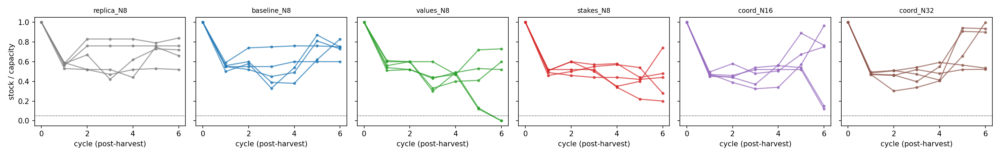
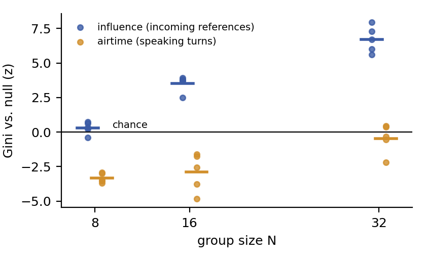
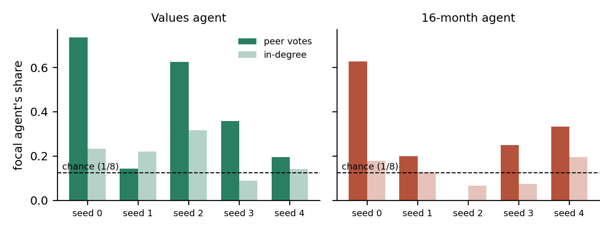
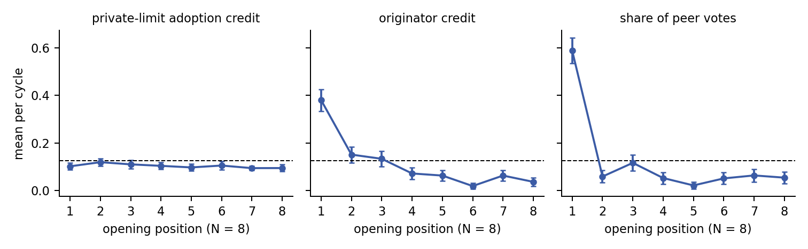

# Conditions for Emergent Leadership in GovSim: results

**In one paragraph.** We simulated leaderless groups of LLM agents (Gemini 2.5 Flash) sharing a fishing commons in GovSim and broke the agents' symmetry three ways:
- one agent privately holds prosocial values and a plan (**values**);
- one agent has a much longer public tenure (**stakes**);
- the group grows from 8 to 16 to 32 agents under a fixed 50-message discussion (**coordination load**).

Peers privately named the prosocial agent, and whoever happened to speak first, as their leader far more often than chance. But the group did not adopt either agent's proposals any more often: perceived and behavioral leadership came apart. Growing the group concentrated influence on a few agents far beyond chance, while speaking turns stayed evenly shared.

| | |
|---|---|
| Runs | 30 (6 conditions × 5 seeds), all complete and validated, frozen source `final-runs-v3` (`6dc5454`) |
| Model | `google/gemini-2.5-flash` via OpenRouter, temperature 0, provider pinned |
| Simulation cost | $49.95 (plus $0.66 for a judge calibration; paid judging is on hold) |
| Design | [`METHODS.md`](METHODS.md) (frozen) · [`analysis/docs/METHODS_UPDATED.md`](analysis/docs/METHODS_UPDATED.md) · [`analysis/docs/ANALYSIS_PLAN.md`](analysis/docs/ANALYSIS_PLAN.md) |
| Full analysis report | [`analysis/docs/ANALYSIS_REPORT.md`](analysis/docs/ANALYSIS_REPORT.md) |
| Hackathon write-up | [`analysis/submission/`](analysis/submission/) (Apart template; placeholders still to fill) |

## 1. Design

| Condition | N | What differs |
|---|---|---|
| `replica_N8` (reference) | 8 | AgentElect No-Leader with the neutral, two-stage discussion protocol; comparability anchor |
| `baseline_N8` | 8 | Reference plus private pre-discussion elicitation and post-discussion "who most influenced the decision?" question; negative control |
| `values_N8` | 8 | Agent in slot `seed % 8` privately gets a prosocial SVO and a sustainability agenda |
| `stakes_N8` | 8 | Public "months remaining" tags; slot `seed % 8` has 16 months, others 3–8; leavers hand over to a household successor |
| `coord_N16`, `coord_N32` | 16, 32 | Lake capacity scaled with N; discussion still capped at 50 messages |

Each month:
1. Agents privately choose a catch.
2. An announcer reads out all catches.
3. Every agent speaks once in a seeded random order (the opening round).
4. Speakers then nominate the next speaker or end the discussion (the nomination phase).
5. Agents reflect, and the lake regrows by a random factor between 1 and 3.

Runs last 6 months.

**Leadership measures:**
- **Proposal adoption:** credit for the agreed limit, from each agent's private pre-discussion limit.
- **Influence graph:** mentions plus agent-made nominations; incoming degree, betweenness, eigenvector centrality. Definitions in [`analysis/metrics.py`](analysis/metrics.py).
- **Peer nominations:** private "who most influenced the decision?" votes.

**Statistics:**
- Five primary tests, Holm-corrected.
- Within-run permutation tests for the focal agents.
- Null models for airtime and influence concentration, with an exact Jonckheere–Terpstra trend test across N.

## 2. Group outcomes were near ceiling

| Condition | Welfare (t) | Survival (cycles) | Survived | Equality | Over-usage |
|---|---|---|---|---|---|
| reference | 195.4 ± 26.5 | 6.0 | 5/5 | 0.955 ± 0.006 | 0.27 ± 0.06 |
| baseline | 189.6 ± 18.7 | 6.0 | 5/5 | 0.956 ± 0.006 | 0.35 ± 0.12 |
| values | 230.2 ± 15.1 | **5.6 ± 0.24** | **3/5** | 0.956 ± 0.015 | 0.61 ± 0.07 |
| stakes | 234.6 ± 9.4 | 6.0 | 5/5 | 0.941 ± 0.010 | 0.63 ± 0.07 |
| N = 16 (capacity 200) | 431.6 ± 62.7 | 6.0 | 5/5 | 0.938 ± 0.013 | 0.51 ± 0.06 |
| N = 32 (capacity 400) | 790.0 ± 141.3 | 6.0 | 5/5 | 0.937 ± 0.010 | 0.35 ± 0.03 |

Values are mean ± SE over 5 seeds. Survival time counts cycles completed before collapse.
- **Collapses:** the only two are values seeds 2 and 3, both in month 6.
- **Over-harvesting:** the values and stakes arms over-harvested more than both controls (Kruskal–Wallis p = 0.004). The gap exceeds the reference-vs-baseline noise floor.



## 3. Primary tests

| Hypothesis | Statistic | p | Holm p |
|---|---|---|---|
| H1a Values agent's proposals adopted more | percentile rank 0.53 (0.5 = chance) | 0.44 | 0.72 |
| H1b Values agent more central (eigenvector) | rank 0.63 | 0.17 | 0.51 |
| H2 16-month agent more central (in-degree) | rank 0.52 | 0.36 | 0.72 |
| H3a Airtime concentrates as N grows | z = −3.3 / −2.9 / −0.5 at N = 8 / 16 / 32 | 0.003 | 0.012 |
| **H3b Influence concentrates as N grows** | z = 0.3 / 3.5 / 6.7 | **1.3 × 10⁻⁶** | **6.6 × 10⁻⁶** |

- **H3a needs care:** airtime is *less* concentrated than a random nomination chain at every N. The significant trend is a move toward chance, not past it.
- **H3b is robust:** it holds when nominations routed by the framework's judge or random fallback are added, and in both discussion phases.



## 4. Peers see a leader that behavior does not show (exploratory)

- **Votes are near-unanimous.** Within each month, 96–99% of named votes go to one agent.
- **Values agent:** 45% of named votes (chance 12.5%; exact permutation p = 0.0008). Framework summaries credit it by name ("Julia's framework"), and 14.5% of all agents' retrieved memories name it, against 0.1% for each peer.
- **Stakes agent (16 months):** 34% of votes (p = 0.04).
- **No behavioral edge:** neither agent's proposals are adopted more often, and neither is significantly more central (section 3).



## 5. Speaking first wins votes, not agreement (exploratory)

The opening order is a seeded random draw, so this is a causal test within the protocol ([`analysis/speaking_order.py`](analysis/speaking_order.py)).

| N = 8 arms pooled | First speaker | Chance | p |
|---|---|---|---|
| Private limit adopted (credit) | 0.10 | 0.10 | 0.51 |
| Public proposal matches the agreement (vs. other proposers) | 0.79 | 0.85 | 0.999 |
| Share of "most influential" votes | **0.59** | 0.125 | < 0.001 |

- **N = 16 and 32:** first speakers get 41% of votes (chance about 4.7%), again with no gain in adoption.
- **Values result weakens without opening months.** The values agent opened 3 of its 30 months. Excluding them, its vote share stays at 41%, but its permutation test weakens to p = 0.065. For the stakes agent it weakens to p = 0.18.
- **Interpretation:** who peers name as leader tracks salience (speaking first, a prosocial plan), not influence on the decision.



## 6. Other findings (exploratory)

- **Stakes endgame.** Agents in their final month caught 1.8 t more than same-month peers (p = 0.002), and 76% of their requests exceeded the sustainability threshold. Household succession did not fully remove last-month over-harvesting.
- **Manipulation checks.** The values agent caught at or below the peer mean in 4 of 5 runs; so did the 16-month agent. Silence in the nomination phase rose to 70% at N = 32.
- **Revised opening numbers.** The first proposer's number usually ends farther from the agreement than a random proposer's.
- **Originator adoption** (proposal extractor, 18% hold-out error): no focal effect.

## 7. Data quality and caveats

- **Clean runs:** no harvest-parse fallbacks, two truncations (N16), no 402 errors, and 100% parsing of both private questions.
- **Many routed hand-offs:** agents often misnamed the next speaker, so 35–47% of nomination hand-offs used the keyed random fallback (12% in baseline). Primary graphs count only nominations the agent made itself.
- **No reasoning tokens.** Every simulation call logged zero reasoning tokens, so the runs likely had extended thinking off, although METHODS assumes default thinking.
- **Small samples.** Five seeds per arm; the focal slot (0–4) is confounded with seed.
- **Ceiling on group outcomes.** Survival and equality have little room to move.
- **Graph definitions.** The study uses the `ANALYSIS_PLAN.md` B2 graph definitions. `check_data.py`'s graph values are legacy; see [`analysis/docs/DISCREPANCIES.md`](analysis/docs/DISCREPANCIES.md).
- **Paid judging not done.** Deference and sentiment judging (plan B6) are on hold. The cost estimate and calibration are in [`analysis/docs/COST_ESTIMATE_B6.md`](analysis/docs/COST_ESTIMATE_B6.md).

## 8. Reproduce

Raw run logs live in `runs/v3/` (git-ignored; not in this repository). With them in place, run from the repo root (pandas, numpy, scipy, networkx, matplotlib):

```bash
PYTHONDONTWRITEBYTECODE=1 python3 -m pytest -q -p no:cacheprovider analysis/tests
PYTHONDONTWRITEBYTECODE=1 python3 analysis/phase1.py
PYTHONDONTWRITEBYTECODE=1 python3 analysis/secondary.py
PYTHONDONTWRITEBYTECODE=1 python3 analysis/speaking_order.py
PYTHONDONTWRITEBYTECODE=1 python3 analysis/paper_figures.py
```

- **Outputs:** every table is in [`analysis/results/`](analysis/results/), every figure in [`analysis/figures/`](analysis/figures/).
- **Random keys:** the keys behind every random draw are in [`analysis/keys_used.json`](analysis/keys_used.json).
- **Tests:** 20 unit tests cover the graph metrics, nulls and inference.

## Appendix: per-run results

| Condition | Seed | Survival (cycles) | Survived | Total catch (t) | Equality | Efficiency | Over-usage | Mean regen | Cost (USD) |
|---|---|---|---|---|---|---|---|---|---|
| replica_N8 | 0 | 6 | yes | 125 | 0.943 | 0.55 | 0.19 | 1.69 | 0.72 |
| replica_N8 | 1 | 6 | yes | 224 | 0.950 | 0.71 | 0.33 | 2.22 | 0.75 |
| replica_N8 | 2 | 6 | yes | 164 | 0.953 | 0.60 | 0.06 | 1.90 | 0.71 |
| replica_N8 | 3 | 6 | yes | 280 | 0.976 | 0.93 | 0.38 | 2.16 | 0.66 |
| replica_N8 | 4 | 6 | yes | 184 | 0.952 | 0.65 | 0.38 | 2.05 | 0.77 |
| baseline_N8 | 0 | 6 | yes | 153 | 0.932 | 0.77 | 0.62 | 1.71 | 0.89 |
| baseline_N8 | 1 | 6 | yes | 168 | 0.954 | 0.71 | 0.56 | 1.74 | 0.89 |
| baseline_N8 | 2 | 6 | yes | 255 | 0.966 | 0.75 | 0.08 | 2.36 | 0.70 |
| baseline_N8 | 3 | 6 | yes | 165 | 0.963 | 0.55 | 0.04 | 2.08 | 0.74 |
| baseline_N8 | 4 | 6 | yes | 207 | 0.967 | 0.73 | 0.44 | 1.96 | 0.84 |
| values_N8 | 0 | 6 | yes | 285 | 0.978 | 0.96 | 0.56 | 2.03 | 0.85 |
| values_N8 | 1 | 6 | yes | 241 | 0.996 | 0.80 | 0.52 | 2.17 | 0.73 |
| values_N8 | 2 | 5 | no | 205 | 0.905 | 1.05 | 0.85 | 1.67 | 0.97 |
| values_N8 | 3 | 5 | no | 212 | 0.954 | 0.84 | 0.67 | 1.94 | 0.80 |
| values_N8 | 4 | 6 | yes | 208 | 0.945 | 0.75 | 0.46 | 1.97 | 0.88 |
| stakes_N8 | 0 | 6 | yes | 219 | 0.931 | 0.75 | 0.42 | 2.11 | 0.96 |
| stakes_N8 | 1 | 6 | yes | 261 | 0.945 | 0.90 | 0.56 | 2.08 | 1.09 |
| stakes_N8 | 2 | 6 | yes | 250 | 0.976 | 0.90 | 0.69 | 1.91 | 0.83 |
| stakes_N8 | 3 | 6 | yes | 233 | 0.937 | 0.85 | 0.65 | 1.95 | 0.93 |
| stakes_N8 | 4 | 6 | yes | 210 | 0.918 | 1.09 | 0.83 | 1.57 | 0.98 |
| coord_N16 | 0 | 6 | yes | 391 | 0.936 | 0.89 | 0.70 | 1.67 | 2.34 |
| coord_N16 | 1 | 6 | yes | 258 | 0.900 | 0.60 | 0.43 | 1.68 | 2.34 |
| coord_N16 | 2 | 6 | yes | 568 | 0.953 | 0.99 | 0.42 | 2.07 | 2.10 |
| coord_N16 | 3 | 6 | yes | 358 | 0.927 | 0.69 | 0.43 | 1.89 | 2.41 |
| coord_N16 | 4 | 6 | yes | 583 | 0.975 | 0.97 | 0.57 | 2.20 | 1.97 |
| coord_N32 | 0 | 6 | yes | 516 | 0.944 | 0.52 | 0.39 | 1.84 | 4.34 |
| coord_N32 | 1 | 6 | yes | 1169 | 0.973 | 0.92 | 0.38 | 2.16 | 3.60 |
| coord_N32 | 2 | 6 | yes | 613 | 0.914 | 0.66 | 0.41 | 1.79 | 5.01 |
| coord_N32 | 3 | 6 | yes | 1097 | 0.923 | 0.87 | 0.23 | 2.15 | 4.75 |
| coord_N32 | 4 | 6 | yes | 555 | 0.932 | 0.63 | 0.36 | 1.73 | 4.40 |

- **Efficiency:** total catch divided by the full-capacity sustainable benchmark over the observed regeneration factors. Values above 1 mean the group caught more than that sustainable yield.
- **Cost:** includes all calls in the run, including hidden nomination-judge calls.
